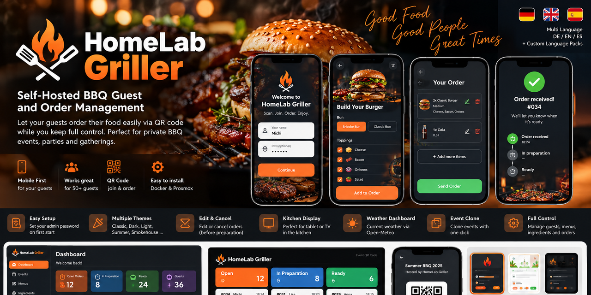

# HomeLab Griller by Pengu

**Scan. Choose. Grill. Enjoy.** A self-hosted, mobile-first BBQ event and guest ordering app for parties, family gatherings and HomeLabs.



HomeLab Griller makes grilling for a group much easier. The host creates an event and a menu, chooses which ingredients are available, and shares the event's QR code. Guests open it on their phones, customize burgers, sides and drinks, and place their orders. A clear grill-master board shows **who needs what, and what is ready** — even with 50 guests.

> **Network recommendation:** Host on a dedicated **guest VLAN/network** or another carefully restricted local network, with only the application port (default **8091**) reachable from guest devices. Many guest Wi-Fi configurations use client isolation: explicitly allow access to the Griller host. Restrict guests from reaching Proxmox, Docker management, NAS and other internal services. The app is intended for **private/LAN use**, not direct public Internet exposure. Use HTTPS if accessing across untrusted networks.

## Docker — install

Create a directory and a `compose.yml`:

```bash
mkdir -p homelab-griller/data && cd homelab-griller
nano compose.yml
```

```yaml
services:
  homelab-griller:
    image: ghcr.io/borderlane-ha/homelab-griller:latest
    container_name: homelab-griller
    restart: unless-stopped
    ports:
      - "8091:80"
    environment:
      TZ: Europe/Berlin
      GRILLER_DEFAULT_LANGUAGE: de
    volumes:
      - ./data:/var/www/html/data
```

```bash
docker compose up -d
docker compose logs --tail=30 homelab-griller
```

Open **`http://YOUR-SERVER-IP:8091`**. On the first visit, choose your admin username and password in the browser. Enter the **one-time setup token** displayed in the container logs. Password must contain at least 12 characters. The token becomes invalid after setup.

## Docker — update

Run in your Compose directory:

```bash
docker compose pull
docker compose up -d
```

Data is stored in `./data`, outside the container. **Back it up before updates.** For a consistent SQLite backup, stop the container temporarily:

```bash
docker compose down
cp -a data "data-backup-$(date +%Y%m%d-%H%M)"
docker compose up -d
```

## Proxmox VE — install

Run **on the Proxmox host** (creates a Debian LXC with Docker):

```bash
bash -c "$(curl -fsSL https://raw.githubusercontent.com/Borderlane-HA/homelab-griller/main/scripts/proxmox-lxc-install.sh)"
```

The installer asks for the container ID, hostname, storage, bridge, DHCP/static network settings and app port (**8091** by default). It prints the **LXC root password** and **web setup token** at the end. Open the displayed URL and create your admin credentials in the first-run wizard.

Docker inside an LXC requires nesting and may depend on your host's kernel/storage setup. For maximum isolation and compatibility, a small Debian VM is an alternative.

## Proxmox VE — update

On the **Proxmox host**, run:

```bash
bash -c "$(curl -fsSL https://raw.githubusercontent.com/Borderlane-HA/homelab-griller/main/scripts/proxmox-lxc-update.sh)"
```

Enter the LXC ID you installed. The updater stops the app briefly, backs up `/opt/homelab-griller/data` to `/opt/homelab-griller/backups/`, pulls the latest container image and starts it again.

## What can it do?

- QR-code guest join, reusable guest profiles with optional four-digit PIN
- Guided mobile ordering, quantities, toppings, notes and beef doneness
- Guests can edit or cancel an order **only until preparation begins**
- Live order status without resetting an unfinished menu
- Grill-master board with search, queues, full-screen mode and automatic updates
- Event creation, publishing, cloning and management of guests and orders
- Reusable ingredient library and product/category management
- **DE / EN / ES**, plus uploadable JSON language packs
- Four themes: **Ember, Smokehouse, Summer Garden, Nordic**
- Optional admin weather widget powered by [Open-Meteo](https://open-meteo.com/)
- Local SQLite persistence, single-container deployment, multi-architecture Docker builds

## Screenshots

Actual v2 screenshots can be added to `docs/screenshots/` and linked here:

| View | Image |
| --- | --- |
| Mobile guest ordering | `docs/screenshots/guest-wizard.png` |
| Guest order status | `docs/screenshots/guest-status.png` |
| Grill-master display | `docs/screenshots/kitchen-board.png` |
| Admin / event setup | `docs/screenshots/admin-dashboard.png` |

*The banner above is a conceptual promotional illustration, not a screenshot of a running installation.*

## Releases and upgrades

GitHub Actions publishes a multi-arch GHCR image (`linux/amd64`, `linux/arm64`, `linux/arm/v7`). A Git tag such as `v2.0.0-beta.1` also triggers a GitHub release containing:

- **Full ZIP:** entire source tree for new source installations
- **Update ZIP:** files changed from the preceding Git tag (source installations only)

Users deploying with Docker or Proxmox should follow the **update commands above**, not unpack ZIP files into the running container.

**Upgrading from v1?** Make a backup of your existing `data` directory. v2 preserves the prior SQLite data and adds settings and reusable ingredients during startup. v1's `GRILLER_ADMIN_PASSWORD` variable is no longer used for login: create your administrator account in the first-run setup after the upgrade. **Test on a copy of your data before replacing a production installation.**

## Development

- PHP 8.3 + Apache + SQLite, no external DB or npm build required
- Source code: `app/`; deployment: `Dockerfile`, `docker-compose.yml`
- Language packs: `app/lang/*.json`; additional packs are uploaded in Admin → Languages
- Admin credentials are stored as a password hash in the SQLite DB; a random setup token is generated separately and printed only in the container logs
- Version: [`VERSION`](VERSION)

Licensed under [MIT](LICENSE).

> **Privacy note:** The optional four-digit guest PIN is a convenience feature for recognizing returning guests, **not strong authentication**. Use the application only on a controlled local network.
